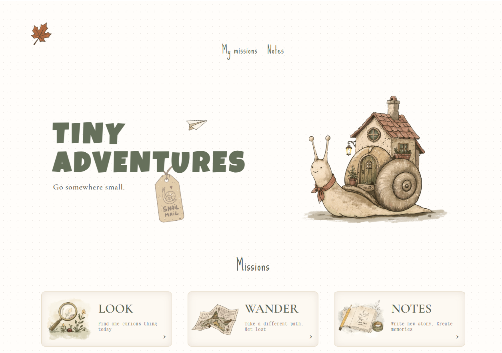

# 🍂 Tiny Adventures

### Go somewhere small.

A cozy interactive web application that encourages curiosity,
creativity and small everyday adventures.

**[🌿 Explore the Live Demo](https://gingerpanda-lab.github.io/tiny-adventures/)**

## About the Project

Tiny Adventures is a personal learning project that combines
creative visual design with frontend web development.

The idea is to turn everyday life into a series of small
adventures through interactive missions and personal journaling.

## Features

- 🔍 LOOK — small observation challenges
- 🗺️ WANDER — exploration missions
- 📖 NOTES — personal adventure diary
- ✅ Mission completion tracking
- 💾 Persistent data storage using LocalStorage
- ✈️ CSS animations and interactive elements
- 📱 Responsive layout
- 🍁 Custom favicon

## Technologies

- HTML5
- CSS3
- JavaScript
- Web Storage API
- Git & GitHub
- GitHub Pages

## What I Learned

- Structuring a multi-page website
- Creating interactive elements and modal windows
- Handling user events with JavaScript
- Storing user data locally in the browser
- Creating CSS animations
- Deploying a website with GitHub Pages
- Debugging case-sensitive file paths
- Using browser Developer Tools

## Future Improvements

- Improved mobile experience
- More adventure categories
- Mission statistics
- Diary export
- Accessibility improvements

---

## 🇩🇪 Projektbeschreibung

Tiny Adventures ist ein persönliches Lernprojekt im Bereich
Webentwicklung, das kreatives Design mit interaktiver
Programmierung verbindet.

Die Anwendung motiviert dazu, kleine Abenteuer im Alltag
zu entdecken, Aufgaben zu erledigen und persönliche
Erlebnisse in einem digitalen Tagebuch festzuhalten.

### Technische Umsetzung

- HTML, CSS und JavaScript
- Interaktive Dialogfenster
- Ereignisverarbeitung
- Lokale Datenspeicherung mit LocalStorage
- CSS-Animationen und responsives Design
- Veröffentlichung über GitHub Pages

### Lernziele

Vertiefung meiner Kenntnisse in der Frontend-Entwicklung,
Benutzeroberflächengestaltung, Fehleranalyse und
Versionsverwaltung.

---

## About Me

I am currently retraining as a software developer
(Fachinformatikerin für Anwendungsentwicklung) in Germany.

With a background in photography and illustration,
I am particularly interested in combining creative design
with web and software development.

Made with curiosity by **GingerPanda Lab**.
